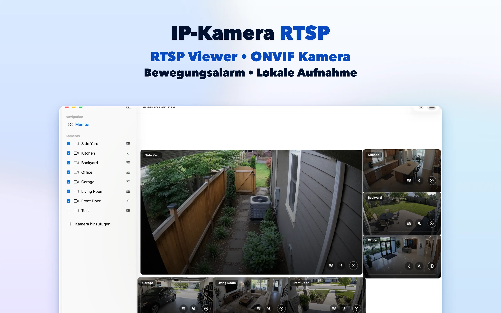
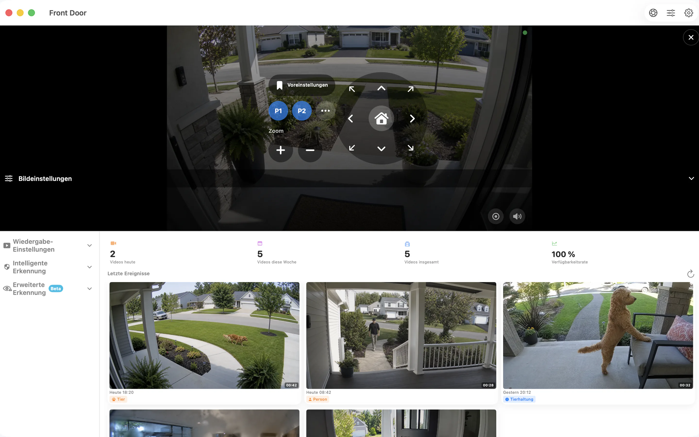

# SmartRTSP für Mac — RTSP- und ONVIF-Kameras ansehen und aufzeichnen

Geben Sie Ihren IP-Kameras einen Platz auf Ihrem Mac-Schreibtisch. SmartRTSP verbindet Live-Kamerabilder, lokale Aufnahmen und Ereignisrückblick für den Arbeitsplatz, Empfang oder die Überwachung kleiner Unternehmen.

**[Über App Store herunterladen](https://apps.apple.com/us/app/smart-rtsp-pro-ip-cam-viewer/id6759788063?mt=12)** · [Offizielle Website](https://www.smartrtsp.com/)

**Sprache wählen**

[English](./README.md) · **Deutsch** · [Français](./README.fr.md) · [Español](./README.es.md) · [Italiano](./README.it.md) · [Português](./README.pt.md) · [Nederlands](./README.nl.md) · [Polski](./README.pl.md) · [Svenska](./README.sv.md) · [Suomi](./README.fi.md) · [Română](./README.ro.md) · [Русский](./README.ru.md) · [Українська](./README.uk.md) · [Türkçe](./README.tr.md)

Behalten Sie Kamerabilder neben Ihrer Arbeit im Blick, ordnen Sie mehrere Ansichten an und sehen Sie sich Aufnahmen in einer Desktop-Oberfläche für größere Bildschirme an.

## App-Screenshots

## Die wichtigsten Funktionen

- **Kameras verbinden** — Fügen Sie kompatible RTSP-Streams hinzu oder suchen Sie ONVIF-Kameras in Ihrem lokalen Netzwerk.
- **Ansicht auswählen** — Wechseln Sie zwischen einzelnen Kamerabildern und einem zu Ihrem Bildschirm passenden Layout mit mehreren Kameras.
- **Aufzeichnen und ansehen** — Speichern Sie Aufnahmen lokal und kehren Sie im Aufnahmeverlauf zu wichtigen Momenten zurück.
- **Relevante Ereignisse finden** — Richten Sie unterstützte Optionen zur Bewegungs-, Personen- oder Geräuscherkennung ein, um interessante Momente leichter zu finden.
- **Kompatible Kameras steuern** — Nutzen Sie Schwenken, Neigen und Zoom, wenn Ihre Kamera einen unterstützten ONVIF-PTZ-Dienst bereitstellt.
- **Lokal ansehen** — Zum lokalen Ansehen ist kein SmartRTSP-Konto erforderlich. Zugangsdaten für die Kamera können dennoch nötig sein.

## SmartRTSP im Alltag

- **Zuhause und Eingänge** — Prüfen Sie Kameras an der Haustür, in der Einfahrt oder in anderen Bereichen rund um Ihr Zuhause.
- **Geschäfte und Empfang** — Behalten Sie mehrere Bereiche eines kleinen Geschäfts oder Empfangs auf einem Bildschirm im Blick.
- **Haustiere und kurze Kontrollblicke** — Öffnen Sie eine kompatible Kamera für einen kurzen Blick auf den Haustierbereich oder ein anderes Zimmer.

## Erste Schritte

1. Installieren Sie SmartRTSP über den offiziellen Store-Link unten.
2. Verbinden Sie Ihr Gerät und die Kamera mit demselben lokalen Netzwerk. Suchen Sie dann nach der Kamera oder fügen Sie ihre unterstützte Stream-Adresse hinzu.
3. Geben Sie bei Bedarf die Kamera-Zugangsdaten ein, öffnen Sie die Liveansicht und wählen Sie die gewünschten Anzeige- oder Aufnahmefunktionen.

## Häufige Fragen

### Welche Kameras funktionieren mit SmartRTSP?

Die Kamera oder der Rekorder muss einen unterstützten RTSP-Stream oder ONVIF-Dienst anbieten. Die Kompatibilität hängt von Modell, Firmware und aktivierten Einstellungen ab. Für PTZ ist ebenfalls eine kompatible Kamera erforderlich.

### Brauche ich ein SmartRTSP-Konto?

Sie können Kameras lokal ohne SmartRTSP-Konto ansehen. Ihre Kamera benötigt gegebenenfalls einen eigenen Benutzernamen und ein Passwort.

### Sind nach dem Herunterladen alle Funktionen enthalten?

Testzeiträume, Pro-Funktionen, verfügbare Käufe und Preise unterscheiden sich je nach Plattform. Das aktuelle Angebot finden Sie in der App und im offiziellen Store-Eintrag. Mehrkameraansicht, Aufnahme und Erkennung können Pro erfordern.

### Wo werden Aufnahmen gespeichert?

Aufnahmen werden auf Ihrem Gerät oder, soweit unterstützt, an einem von Ihnen gewählten Ort gespeichert. Optionale Netzwerkdienste richten sich nach den von Ihnen aktivierten Einstellungen.

## SmartRTSP herunterladen

**[Über App Store herunterladen](https://apps.apple.com/us/app/smart-rtsp-pro-ip-cam-viewer/id6759788063?mt=12)**

## Offizielle Links

- [Offizielle Website](https://www.smartrtsp.com/)
- [Hilfe und Kamera-Anleitungen](https://www.smartrtsp.com/guides/)
- [Datenschutzerklärung](https://www.smartrtsp.com/privacy)

## Weitere Plattformen

[iPhone](https://github.com/smartrtsp/smartrtsp-iphone/blob/main/README.de.md) · [iPad](https://github.com/smartrtsp/smartrtsp-ipad/blob/main/README.de.md) · [Apple TV](https://github.com/smartrtsp/smartrtsp-tvos/blob/main/README.de.md) · [Android-Smartphones und -Tablets](https://github.com/smartrtsp/smartrtsp-android/blob/main/README.de.md) · [Android TV und Google TV](https://github.com/smartrtsp/smartrtsp-android-tv/blob/main/README.de.md) · [Windows](https://github.com/smartrtsp/smartrtsp-windows/blob/main/README.de.md)
