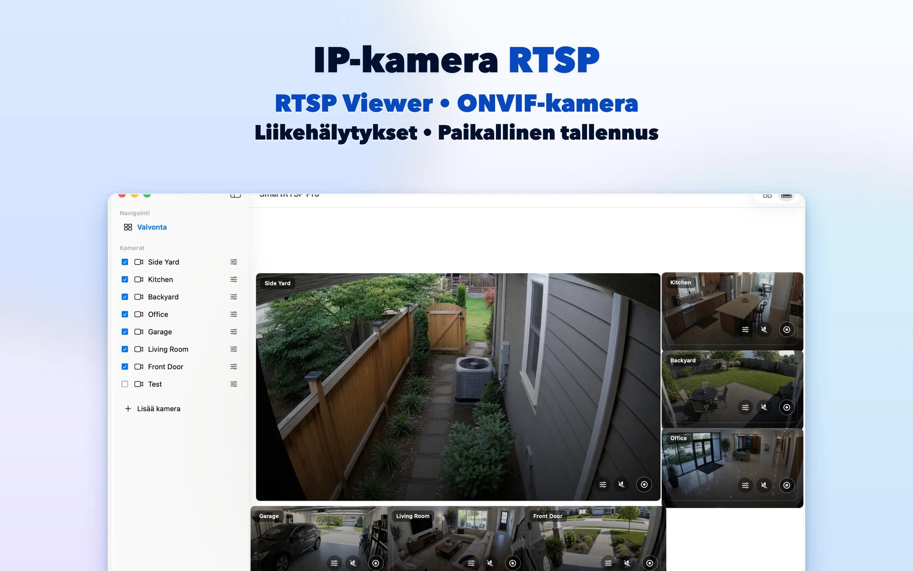
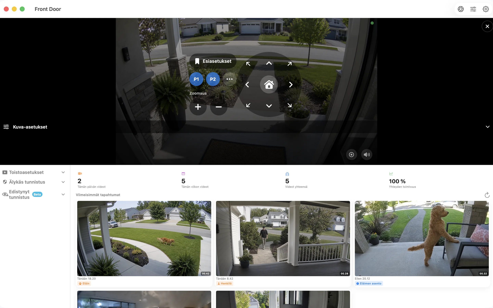

# SmartRTSP Macille — RTSP- ja ONVIF-kameroiden katselu ja tallennus

Tee IP-kameroille tilaa Macin työpöydällä. SmartRTSP yhdistää reaaliaikaiset kamerakuvat, paikallisen tallennuksen ja tapahtumien tarkastelun työpisteessä, vastaanotossa tai pienyrityksen valvontapisteessä.

**[Lataa kaupasta App Store](https://apps.apple.com/us/app/smart-rtsp-pro-ip-cam-viewer/id6759788063?mt=12)** · [Virallinen verkkosivusto](https://www.smartrtsp.com/)

**Valitse kieli**

[English](./README.md) · [Deutsch](./README.de.md) · [Français](./README.fr.md) · [Español](./README.es.md) · [Italiano](./README.it.md) · [Português](./README.pt.md) · [Nederlands](./README.nl.md) · [Polski](./README.pl.md) · [Svenska](./README.sv.md) · **Suomi** · [Română](./README.ro.md) · [Русский](./README.ru.md) · [Українська](./README.uk.md) · [Türkçe](./README.tr.md)

Pidä kamerakuvat näkyvissä työn ohessa, järjestä useita videovirtoja ja katso tallenteita suuremmalle näytölle suunnitellussa työpöytäkäyttöliittymässä.

## Sovelluksen näyttökuvat

## Keskeiset ominaisuudet

- **Yhdistä kamerasi** — Lisää yhteensopivia RTSP-videovirtoja tai etsi ONVIF-kameroita lähiverkostasi.
- **Valitse näkymä** — Vaihda yksittäisten kamerakuvien ja näytöllesi sopivan usean kameran asettelun välillä.
- **Tallenna ja katso uudelleen** — Tallenna videot paikallisesti ja palaa tärkeisiin hetkiin tallennushistoriassa.
- **Löydä olennaiset tapahtumat** — Määritä tuetut liikkeen, ihmisten tai äänen tunnistuksen asetukset, jotta löydät tarkastelun arvoiset hetket.
- **Ohjaa yhteensopivia kameroita** — Käytä panorointia, kallistusta ja zoomausta, kun kamera tarjoaa tuetun ONVIF PTZ -palvelun.
- **Katsele paikallisesti** — Paikallinen kameran katselu ei vaadi SmartRTSP-tiliä. Kameran omat kirjautumistiedot voivat silti olla tarpeen.

## SmartRTSP arjessa

- **Koti ja sisäänkäynnit** — Tarkista sisäänkäyntiä, ajotietä tai muuta kodin ympäristöä kuvaavat kamerat.
- **Myymälät ja vastaanotot** — Seuraa pienen myymälän tai vastaanottotilan useita alueita yhdeltä näytöltä.
- **Lemmikit ja arjen tarkistukset** — Avaa yhteensopiva kamera ja vilkaise nopeasti lemmikin tilaa tai toista huonetta.

## Aloittaminen

1. Asenna SmartRTSP alla olevasta virallisesta kauppalinkistä.
2. Yhdistä laitteesi ja kamera samaan lähiverkkoon. Etsi sen jälkeen kamera tai lisää sen tuettu videovirran osoite.
3. Anna tarvittaessa kameran kirjautumistiedot, avaa reaaliaikainen näkymä ja valitse haluamasi katselu- tai tallennustoiminnot.

## Usein kysytyt kysymykset

### Mitkä kamerat toimivat SmartRTSP:n kanssa?

Kameran tai tallentimen on tarjottava tuettu RTSP-videovirta tai ONVIF-palvelu. Yhteensopivuus riippuu mallista, laiteohjelmistosta ja käytössä olevista asetuksista. Myös PTZ-ohjaus edellyttää yhteensopivaa kameraa.

### Tarvitsenko SmartRTSP-tilin?

Voit katsella paikallisia kameroita ilman SmartRTSP-tiliä. Kamera voi vaatia oman käyttäjätunnuksensa ja salasanansa.

### Sisältyvätkö kaikki ominaisuudet lataukseen?

Kokeilujaksot, Pro-ominaisuudet, saatavilla olevat ostot ja hinnat vaihtelevat alustan mukaan. Tarkista ajantasainen tarjous sovelluksesta ja sen viralliselta kauppasivulta. Esimerkiksi usean kameran katselu, tallennus ja tunnistus voivat edellyttää Pro-versiota.

### Missä tallenteet säilytetään?

Tallenteet tallennetaan laitteellesi tai valitsemaasi sijaintiin, jos sitä tuetaan. Valinnaiset verkkopalvelut toimivat käyttöön ottamiesi asetusten mukaisesti.

## Lataa SmartRTSP

**[Lataa kaupasta App Store](https://apps.apple.com/us/app/smart-rtsp-pro-ip-cam-viewer/id6759788063?mt=12)**

## Viralliset linkit

- [Virallinen verkkosivusto](https://www.smartrtsp.com/)
- [Ohjeet ja kameraoppaat](https://www.smartrtsp.com/guides/)
- [Tietosuojakäytäntö](https://www.smartrtsp.com/privacy)

## Muut alustat

[iPhone](https://github.com/smartrtsp/smartrtsp-iphone/blob/main/README.fi.md) · [iPad](https://github.com/smartrtsp/smartrtsp-ipad/blob/main/README.fi.md) · [Apple TV](https://github.com/smartrtsp/smartrtsp-tvos/blob/main/README.fi.md) · [Android-puhelimet ja -tabletit](https://github.com/smartrtsp/smartrtsp-android/blob/main/README.fi.md) · [Android TV ja Google TV](https://github.com/smartrtsp/smartrtsp-android-tv/blob/main/README.fi.md) · [Windows](https://github.com/smartrtsp/smartrtsp-windows/blob/main/README.fi.md)
