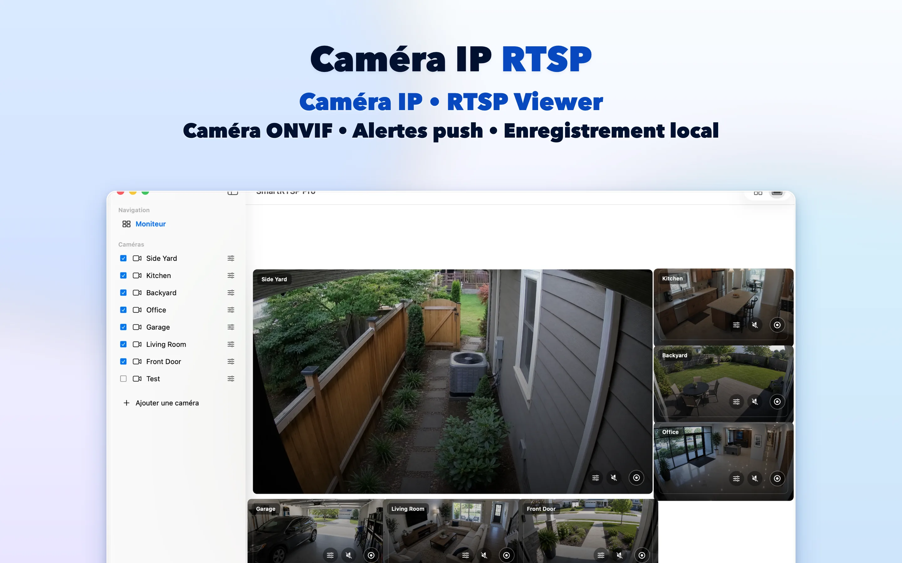
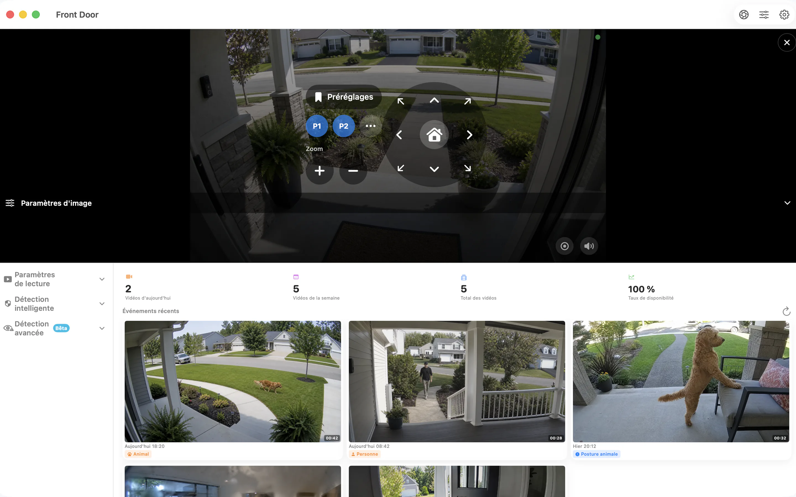

# SmartRTSP pour Mac — Visualisation et enregistrement de caméras RTSP et ONVIF

Faites une place à vos caméras IP sur le bureau de votre Mac. SmartRTSP réunit vues en direct, enregistrement local et consultation des événements pour un poste de travail, un accueil ou une petite entreprise.

**[Télécharger sur App Store](https://apps.apple.com/us/app/smart-rtsp-pro-ip-cam-viewer/id6759788063?mt=12)** · [Site officiel](https://www.smartrtsp.com/)

**Choisir votre langue**

[English](./README.md) · [Deutsch](./README.de.md) · **Français** · [Español](./README.es.md) · [Italiano](./README.it.md) · [Português](./README.pt.md) · [Nederlands](./README.nl.md) · [Polski](./README.pl.md) · [Svenska](./README.sv.md) · [Suomi](./README.fi.md) · [Română](./README.ro.md) · [Русский](./README.ru.md) · [Українська](./README.uk.md) · [Türkçe](./README.tr.md)

Gardez les caméras visibles pendant que vous travaillez, organisez plusieurs vues et consultez vos enregistrements dans une interface de bureau conçue pour un grand écran.

## Captures de l’application

## Principales fonctionnalités

- **Connectez vos caméras** — Ajoutez des flux RTSP compatibles ou découvrez les caméras ONVIF de votre réseau local.
- **Choisissez votre vue** — Passez d’une caméra à une disposition multicaméra adaptée à votre écran.
- **Enregistrez et revoyez** — Sauvegardez les enregistrements localement et retrouvez les moments importants dans l’historique.
- **Repérez les événements utiles** — Configurez les options compatibles de détection de mouvements, de personnes ou de sons pour repérer les moments à revoir.
- **Commandez les caméras compatibles** — Utilisez les commandes de panoramique, d’inclinaison et de zoom lorsque la caméra fournit un service ONVIF PTZ pris en charge.
- **Consultez en local** — La visualisation locale des caméras ne nécessite pas de compte SmartRTSP. Les identifiants de la caméra peuvent toutefois être nécessaires.

## SmartRTSP au quotidien

- **Maison et entrées** — Consultez les caméras qui couvrent une entrée, une allée ou d’autres espaces autour de votre maison.
- **Boutiques et accueils** — Surveillez plusieurs zones d’une petite boutique ou d’un espace d’accueil depuis un seul écran.
- **Animaux et vérifications rapides** — Ouvrez une caméra compatible pour jeter un coup d’œil à l’espace de votre animal ou à une autre pièce.

## Premiers pas

1. Installez SmartRTSP depuis le lien officiel de la boutique ci-dessous.
2. Connectez votre appareil et votre caméra au même réseau local, puis lancez la découverte ou ajoutez l’adresse de son flux compatible.
3. Saisissez les identifiants de la caméra si nécessaire, ouvrez la vue en direct et choisissez les fonctions de visualisation ou d’enregistrement souhaitées.

## Questions fréquentes

### Quelles caméras fonctionnent avec SmartRTSP ?

La caméra ou l’enregistreur doit fournir un flux RTSP ou un service ONVIF pris en charge. La compatibilité dépend du modèle, du micrologiciel et des réglages activés. Les commandes PTZ nécessitent aussi une caméra compatible.

### Ai-je besoin d’un compte SmartRTSP ?

Vous pouvez consulter vos caméras en local sans compte SmartRTSP. Votre caméra peut demander son propre nom d’utilisateur et mot de passe.

### Toutes les fonctionnalités sont-elles incluses au téléchargement ?

Les essais, les fonctions Pro, les achats proposés et les prix varient selon la plateforme. Consultez l’application et sa fiche officielle en boutique pour connaître l’offre actuelle. La vue multicaméra, l’enregistrement et la détection peuvent nécessiter Pro.

### Où les enregistrements sont-ils conservés ?

Les enregistrements sont sauvegardés sur votre appareil ou à l’emplacement de votre choix lorsque cette option est prise en charge. Les services réseau facultatifs suivent les réglages que vous activez.

## Télécharger SmartRTSP

**[Télécharger sur App Store](https://apps.apple.com/us/app/smart-rtsp-pro-ip-cam-viewer/id6759788063?mt=12)**

## Liens officiels

- [Site officiel](https://www.smartrtsp.com/)
- [Aide et guides pour les caméras](https://www.smartrtsp.com/guides/)
- [Politique de confidentialité](https://www.smartrtsp.com/privacy)

## Autres plateformes

[iPhone](https://github.com/smartrtsp/smartrtsp-iphone/blob/main/README.fr.md) · [iPad](https://github.com/smartrtsp/smartrtsp-ipad/blob/main/README.fr.md) · [Apple TV](https://github.com/smartrtsp/smartrtsp-tvos/blob/main/README.fr.md) · [Téléphones et tablettes Android](https://github.com/smartrtsp/smartrtsp-android/blob/main/README.fr.md) · [Android TV et Google TV](https://github.com/smartrtsp/smartrtsp-android-tv/blob/main/README.fr.md) · [Windows](https://github.com/smartrtsp/smartrtsp-windows/blob/main/README.fr.md)
