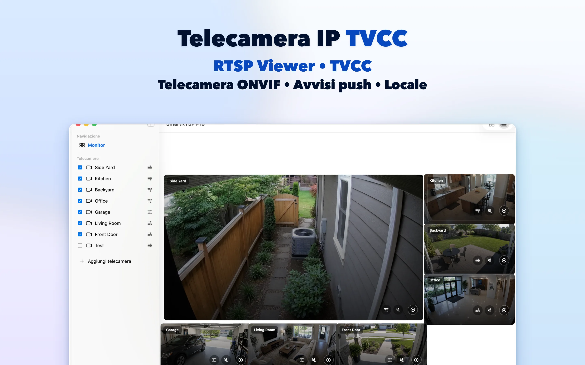
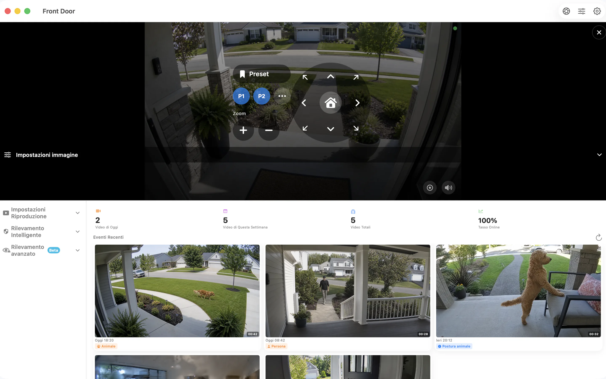

# SmartRTSP per Mac — Visualizzazione e registrazione di telecamere RTSP e ONVIF

Fai spazio alle tue telecamere IP sulla scrivania del Mac. SmartRTSP combina immagini in diretta, registrazione locale e consultazione degli eventi per la scrivania, la reception o la postazione di controllo di una piccola attività.

**[Scarica da App Store](https://apps.apple.com/us/app/smart-rtsp-pro-ip-cam-viewer/id6759788063?mt=12)** · [Sito ufficiale](https://www.smartrtsp.com/)

**Scegli la lingua**

[English](./README.md) · [Deutsch](./README.de.md) · [Français](./README.fr.md) · [Español](./README.es.md) · **Italiano** · [Português](./README.pt.md) · [Nederlands](./README.nl.md) · [Polski](./README.pl.md) · [Svenska](./README.sv.md) · [Suomi](./README.fi.md) · [Română](./README.ro.md) · [Русский](./README.ru.md) · [Українська](./README.uk.md) · [Türkçe](./README.tr.md)

Tieni d’occhio le telecamere mentre lavori, organizza più immagini e rivedi le registrazioni da un’interfaccia desktop pensata per uno schermo più grande.

## Schermate dell’app

## Funzioni principali

- **Collega le tue telecamere** — Aggiungi flussi RTSP compatibili o trova le telecamere ONVIF nella rete locale.
- **Scegli la visualizzazione** — Passa dalle singole telecamere a una disposizione multicamera adatta al tuo schermo.
- **Registra e rivedi** — Salva le registrazioni in locale e ritrova i momenti importanti nella cronologia.
- **Trova gli eventi utili** — Configura le opzioni supportate per il rilevamento di movimento, persone o suoni per individuare i momenti da rivedere.
- **Controlla le telecamere compatibili** — Usa i comandi di panoramica, inclinazione e zoom quando la telecamera offre un servizio ONVIF PTZ supportato.
- **Guarda sulla rete locale** — La visualizzazione locale delle telecamere non richiede un account SmartRTSP. Potrebbero comunque servire le credenziali della telecamera.

## SmartRTSP nella vita quotidiana

- **Casa e ingressi** — Controlla le telecamere che inquadrano un ingresso, un vialetto o altre aree intorno a casa.
- **Negozi e reception** — Tieni d’occhio più aree di un piccolo negozio o di una reception da un solo schermo.
- **Animali e controlli veloci** — Apri una telecamera compatibile per dare un’occhiata allo spazio del tuo animale o a un’altra stanza.

## Primi passi

1. Installa SmartRTSP dal link dello store ufficiale riportato qui sotto.
2. Collega il dispositivo e la telecamera alla stessa rete locale, poi cerca la telecamera o aggiungi l’indirizzo del suo flusso supportato.
3. Inserisci le credenziali della telecamera se richieste, apri la vista in diretta e scegli le funzioni di visualizzazione o registrazione desiderate.

## Domande frequenti

### Quali telecamere funzionano con SmartRTSP?

La telecamera o il registratore deve fornire un flusso RTSP o un servizio ONVIF supportato. La compatibilità dipende dal modello, dal firmware e dalle impostazioni attive. Anche i controlli PTZ richiedono una telecamera compatibile.

### Serve un account SmartRTSP?

Puoi guardare le telecamere in locale senza un account SmartRTSP. La telecamera potrebbe richiedere un nome utente e una password propri.

### Il download include tutte le funzioni?

Periodi di prova, funzioni Pro, acquisti disponibili e prezzi variano in base alla piattaforma. Controlla l’app e la sua pagina ufficiale nello store per conoscere l’offerta attuale. Visualizzazione multicamera, registrazione e rilevamento potrebbero richiedere Pro.

### Dove vengono conservate le registrazioni?

Le registrazioni vengono salvate sul dispositivo o in una posizione scelta da te, dove supportato. I servizi di rete facoltativi seguono le impostazioni che attivi.

## Scarica SmartRTSP

**[Scarica da App Store](https://apps.apple.com/us/app/smart-rtsp-pro-ip-cam-viewer/id6759788063?mt=12)**

## Link ufficiali

- [Sito ufficiale](https://www.smartrtsp.com/)
- [Assistenza e guide per le telecamere](https://www.smartrtsp.com/guides/)
- [Informativa sulla privacy](https://www.smartrtsp.com/privacy)

## Altre piattaforme

[iPhone](https://github.com/smartrtsp/smartrtsp-iphone/blob/main/README.it.md) · [iPad](https://github.com/smartrtsp/smartrtsp-ipad/blob/main/README.it.md) · [Apple TV](https://github.com/smartrtsp/smartrtsp-tvos/blob/main/README.it.md) · [Telefoni e tablet Android](https://github.com/smartrtsp/smartrtsp-android/blob/main/README.it.md) · [Android TV e Google TV](https://github.com/smartrtsp/smartrtsp-android-tv/blob/main/README.it.md) · [Windows](https://github.com/smartrtsp/smartrtsp-windows/blob/main/README.it.md)
