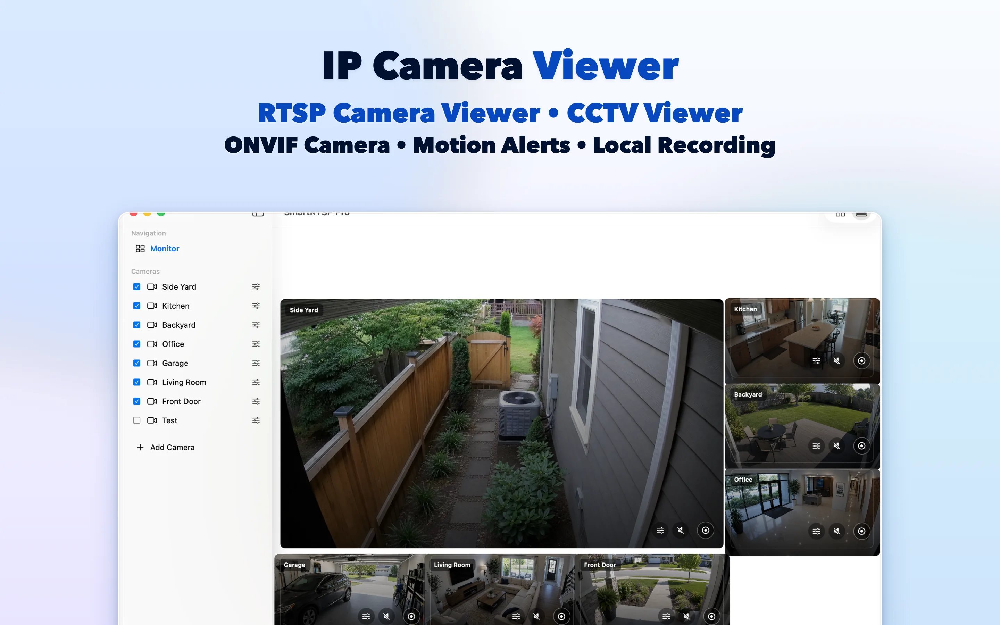
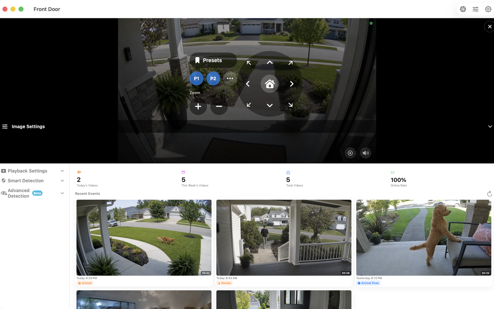

# SmartRTSP for Mac — RTSP & ONVIF Camera Viewer and Recorder

Make room for your IP cameras on your Mac desktop. SmartRTSP combines live camera views, local recording and event review for a desk, reception area or small-business monitoring station.

**[Download from App Store](https://apps.apple.com/us/app/smart-rtsp-pro-ip-cam-viewer/id6759788063?mt=12)** · [Official website](https://www.smartrtsp.com/)

**Choose your language**

**English** · [Deutsch](./README.de.md) · [Français](./README.fr.md) · [Español](./README.es.md) · [Italiano](./README.it.md) · [Português](./README.pt.md) · [Nederlands](./README.nl.md) · [Polski](./README.pl.md) · [Svenska](./README.sv.md) · [Suomi](./README.fi.md) · [Română](./README.ro.md) · [Русский](./README.ru.md) · [Українська](./README.uk.md) · [Türkçe](./README.tr.md)

Keep camera views alongside your work, organize several feeds and review recordings from a desktop interface designed for a larger screen.

## App screenshots

## Main features

- **Connect your cameras** — Add compatible RTSP streams or discover ONVIF cameras on your local network.
- **Choose your view** — Switch between individual camera views and a multi-camera layout that suits your screen.
- **Record and review** — Save recordings locally and return to important moments in the recording history.
- **Find useful events** — Configure supported motion, person or sound detection options to help identify moments worth reviewing.
- **Control compatible cameras** — Use pan, tilt and zoom controls when the camera exposes a supported ONVIF PTZ service.
- **Use local viewing** — Local camera viewing does not require a SmartRTSP account. Camera sign-in details may still be needed.

## Where SmartRTSP fits

- **Home and entrances** — Check the cameras covering an entrance, driveway or other area around your home.
- **Shops and reception desks** — Keep an eye on several areas of a small shop or reception space from one screen.
- **Pets and everyday checks** — Open a compatible camera for a quick look at a pet area or another room.

## Get started

1. Install SmartRTSP from the official store link below.
2. Connect your device and camera to the same local network, then discover the camera or add its supported stream address.
3. Enter the camera credentials when needed, open live view and choose the viewing or recording features you want.

## Frequently asked questions

### Which cameras work with SmartRTSP?

The camera or recorder must provide a supported RTSP stream or ONVIF service. Compatibility depends on its model, firmware and enabled settings. PTZ controls also require a compatible camera.

### Do I need a SmartRTSP account?

You can use local camera viewing without a SmartRTSP account. Your camera may require its own username and password.

### Is every feature included in the download?

Trials, Pro features, available purchases and prices vary by platform. Check the app and its official store listing for the current offer. Features such as multiple-camera viewing, recording and detection may require Pro.

### Where are recordings kept?

Recordings are saved on your device or in a location you choose where supported. Optional network services follow the settings you enable.

## Download SmartRTSP

**[Download from App Store](https://apps.apple.com/us/app/smart-rtsp-pro-ip-cam-viewer/id6759788063?mt=12)**

## Official links

- [Official website](https://www.smartrtsp.com/)
- [Help and camera guides](https://www.smartrtsp.com/guides/)
- [Privacy policy](https://www.smartrtsp.com/privacy)

## Other platforms

[iPhone](https://github.com/smartrtsp/smartrtsp-iphone) · [iPad](https://github.com/smartrtsp/smartrtsp-ipad) · [Apple TV](https://github.com/smartrtsp/smartrtsp-tvos) · [Android phones and tablets](https://github.com/smartrtsp/smartrtsp-android) · [Android TV and Google TV](https://github.com/smartrtsp/smartrtsp-android-tv) · [Windows](https://github.com/smartrtsp/smartrtsp-windows)
