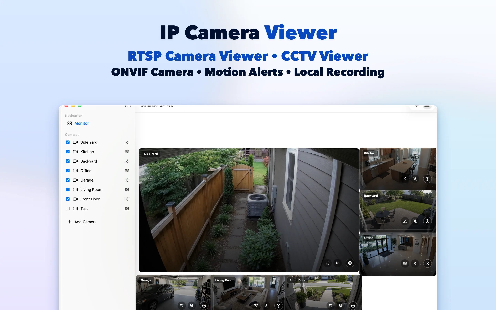
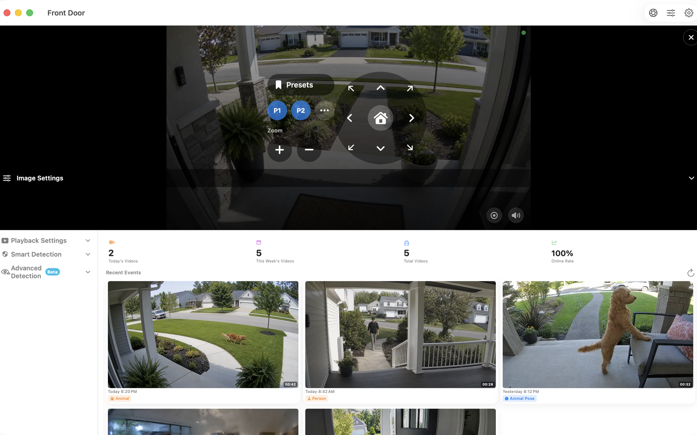

# SmartRTSP voor Mac — RTSP- en ONVIF-camera’s bekijken en opnemen

Geef je IP-camera’s een plek op het bureaublad van je Mac. SmartRTSP combineert live camerabeelden, lokale opnamen en het terugkijken van gebeurtenissen voor je bureau, receptie of kleine onderneming.

**[Downloaden via App Store](https://apps.apple.com/us/app/smart-rtsp-pro-ip-cam-viewer/id6759788063?mt=12)** · [Officiële website](https://www.smartrtsp.com/)

**Kies je taal**

[English](./README.md) · [Deutsch](./README.de.md) · [Français](./README.fr.md) · [Español](./README.es.md) · [Italiano](./README.it.md) · [Português](./README.pt.md) · **Nederlands** · [Polski](./README.pl.md) · [Svenska](./README.sv.md) · [Suomi](./README.fi.md) · [Română](./README.ro.md) · [Русский](./README.ru.md) · [Українська](./README.uk.md) · [Türkçe](./README.tr.md)

Houd camerabeelden naast je werk in beeld, orden meerdere streams en bekijk opnamen in een desktopinterface voor een groter scherm.

## Schermafbeeldingen

*Deze schermafbeelding toont de app in het Engels.*

## Belangrijkste functies

- **Verbind je camera’s** — Voeg compatibele RTSP-streams toe of zoek ONVIF-camera’s op je lokale netwerk.
- **Kies je weergave** — Schakel tussen afzonderlijke camerabeelden en een indeling met meerdere camera’s die bij je scherm past.
- **Opnemen en terugkijken** — Sla opnamen lokaal op en vind belangrijke momenten terug in de opnamegeschiedenis.
- **Vind relevante gebeurtenissen** — Stel de ondersteunde opties voor bewegings-, persoons- of geluidsdetectie in om momenten te herkennen die je wilt terugkijken.
- **Bedien compatibele camera’s** — Gebruik pan-, kantel- en zoomfuncties wanneer de camera een ondersteunde ONVIF PTZ-service aanbiedt.
- **Lokaal bekijken** — Voor lokaal camerabeeld heb je geen SmartRTSP-account nodig. De camera kan wel om inloggegevens vragen.

## SmartRTSP in de praktijk

- **Thuis en bij de ingang** — Bekijk de camera’s bij een ingang, oprit of andere plek rond je huis.
- **Winkels en recepties** — Houd verschillende delen van een kleine winkel of receptie vanaf één scherm in de gaten.
- **Huisdieren en dagelijkse controles** — Open een compatibele camera om snel bij een huisdier of in een andere kamer te kijken.

## Aan de slag

1. Installeer SmartRTSP via de officiële winkellink hieronder.
2. Verbind je apparaat en camera met hetzelfde lokale netwerk. Zoek vervolgens de camera of voeg het ondersteunde streamadres toe.
3. Voer zo nodig de inloggegevens van de camera in, open het livebeeld en kies de gewenste kijk- of opnamefuncties.

## Veelgestelde vragen

### Welke camera’s werken met SmartRTSP?

De camera of recorder moet een ondersteunde RTSP-stream of ONVIF-service aanbieden. Compatibiliteit hangt af van het model, de firmware en de ingeschakelde instellingen. Ook voor PTZ-bediening is een compatibele camera nodig.

### Heb ik een SmartRTSP-account nodig?

Je kunt lokale camerabeelden bekijken zonder SmartRTSP-account. Je camera kan wel een eigen gebruikersnaam en wachtwoord vereisen.

### Zijn alle functies inbegrepen bij de download?

Proefperiodes, Pro-functies, beschikbare aankopen en prijzen verschillen per platform. Bekijk de app en de officiële winkelpagina voor het actuele aanbod. Voor functies zoals meerdere camera’s tegelijk bekijken, opnemen en detectie kan Pro vereist zijn.

### Waar worden opnamen opgeslagen?

Opnamen worden opgeslagen op je apparaat of op een door jou gekozen locatie, waar dit wordt ondersteund. Optionele netwerkdiensten volgen de instellingen die je inschakelt.

## SmartRTSP downloaden

**[Downloaden via App Store](https://apps.apple.com/us/app/smart-rtsp-pro-ip-cam-viewer/id6759788063?mt=12)**

## Officiële links

- [Officiële website](https://www.smartrtsp.com/)
- [Hulp en cameragidsen](https://www.smartrtsp.com/guides/)
- [Privacybeleid](https://www.smartrtsp.com/privacy)

## Andere platforms

[iPhone](https://github.com/smartrtsp/smartrtsp-iphone/blob/main/README.nl.md) · [iPad](https://github.com/smartrtsp/smartrtsp-ipad/blob/main/README.nl.md) · [Apple TV](https://github.com/smartrtsp/smartrtsp-tvos/blob/main/README.nl.md) · [Android-telefoons en -tablets](https://github.com/smartrtsp/smartrtsp-android/blob/main/README.nl.md) · [Android TV en Google TV](https://github.com/smartrtsp/smartrtsp-android-tv/blob/main/README.nl.md) · [Windows](https://github.com/smartrtsp/smartrtsp-windows/blob/main/README.nl.md)
