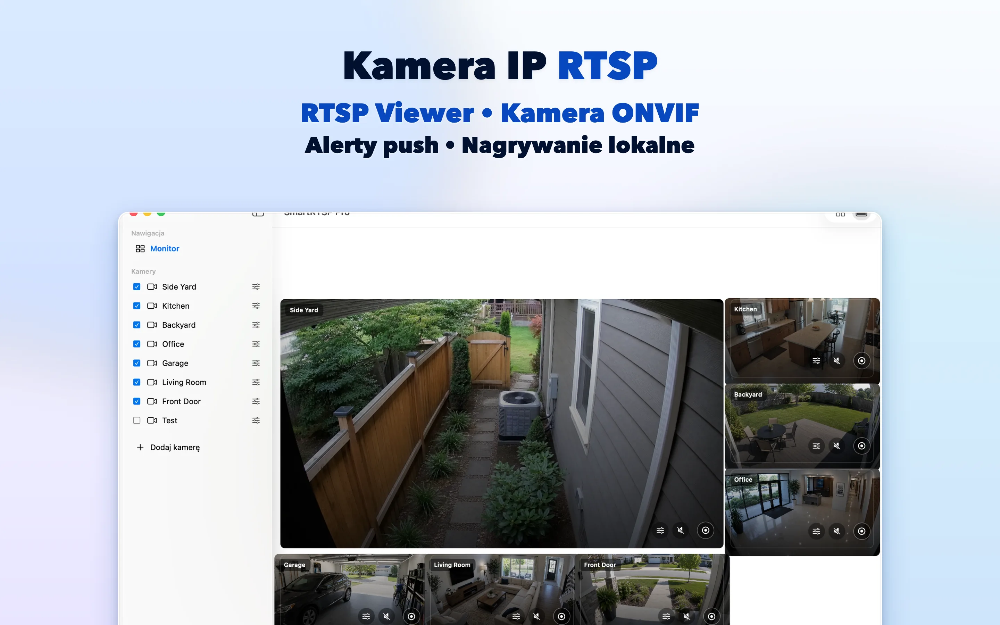
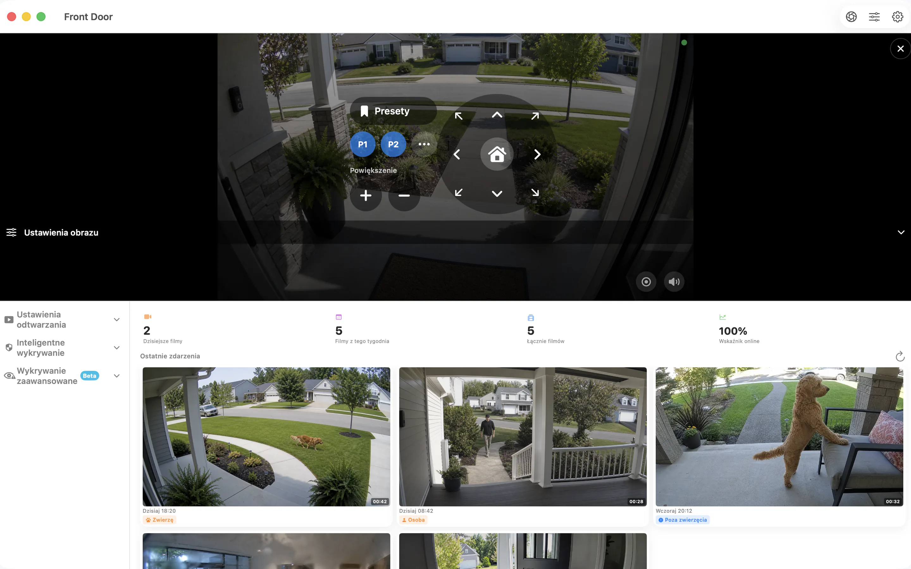

# SmartRTSP na Maca — Podgląd i nagrywanie kamer RTSP i ONVIF

Znajdź miejsce dla kamer IP na biurku Maca. SmartRTSP łączy podgląd na żywo, nagrywanie lokalne i przeglądanie zdarzeń na stanowisku pracy, recepcji lub w niewielkiej firmie.

**[Pobierz ze sklepu App Store](https://apps.apple.com/us/app/smart-rtsp-pro-ip-cam-viewer/id6759788063?mt=12)** · [Oficjalna strona](https://www.smartrtsp.com/)

**Wybierz język**

[English](./README.md) · [Deutsch](./README.de.md) · [Français](./README.fr.md) · [Español](./README.es.md) · [Italiano](./README.it.md) · [Português](./README.pt.md) · [Nederlands](./README.nl.md) · **Polski** · [Svenska](./README.sv.md) · [Suomi](./README.fi.md) · [Română](./README.ro.md) · [Русский](./README.ru.md) · [Українська](./README.uk.md) · [Türkçe](./README.tr.md)

Obserwuj kamery obok swojej pracy, uporządkuj kilka strumieni i przeglądaj nagrania w interfejsie komputerowym zaprojektowanym z myślą o większym ekranie.

## Zrzuty ekranu aplikacji

## Najważniejsze funkcje

- **Połącz swoje kamery** — Dodaj zgodne strumienie RTSP lub wykryj kamery ONVIF w sieci lokalnej.
- **Wybierz widok** — Przełączaj się między pojedynczymi kamerami a układem wielu kamer dopasowanym do ekranu.
- **Nagrywaj i przeglądaj** — Zapisuj nagrania lokalnie i wracaj do ważnych chwil w historii nagrań.
- **Znajdź istotne zdarzenia** — Skonfiguruj obsługiwane opcje wykrywania ruchu, osób lub dźwięku, aby łatwiej odnajdywać chwile warte sprawdzenia.
- **Steruj zgodnymi kamerami** — Korzystaj z obrotu, pochylenia i zoomu, jeśli kamera udostępnia obsługiwaną usługę ONVIF PTZ.
- **Korzystaj z podglądu lokalnego** — Lokalny podgląd kamer nie wymaga konta SmartRTSP. Dane logowania do kamery mogą nadal być potrzebne.

## Gdzie przyda się SmartRTSP

- **Dom i wejścia** — Sprawdzaj kamery przy wejściu, na podjeździe lub w innych miejscach wokół domu.
- **Sklepy i recepcje** — Obserwuj kilka obszarów małego sklepu lub recepcji na jednym ekranie.
- **Zwierzęta i codzienny podgląd** — Otwórz zgodną kamerę, aby szybko zajrzeć do zwierzęcia lub innego pokoju.

## Pierwsze kroki

1. Zainstaluj SmartRTSP, korzystając z poniższego odnośnika do oficjalnego sklepu.
2. Połącz urządzenie i kamerę z tą samą siecią lokalną, a następnie wykryj kamerę lub dodaj obsługiwany adres strumienia.
3. W razie potrzeby wpisz dane logowania do kamery, otwórz podgląd na żywo i wybierz funkcje oglądania lub nagrywania.

## Często zadawane pytania

### Które kamery działają ze SmartRTSP?

Kamera lub rejestrator musi udostępniać obsługiwany strumień RTSP albo usługę ONVIF. Zgodność zależy od modelu, oprogramowania sprzętowego i włączonych ustawień. Sterowanie PTZ również wymaga zgodnej kamery.

### Czy potrzebuję konta SmartRTSP?

Z lokalnego podglądu kamer można korzystać bez konta SmartRTSP. Kamera może wymagać własnej nazwy użytkownika i hasła.

### Czy pobranie aplikacji obejmuje wszystkie funkcje?

Okresy próbne, funkcje Pro, dostępne zakupy i ceny zależą od platformy. Aktualną ofertę znajdziesz w aplikacji i na jej oficjalnej stronie w sklepie. Funkcje takie jak podgląd wielu kamer, nagrywanie i wykrywanie mogą wymagać Pro.

### Gdzie są przechowywane nagrania?

Nagrania są zapisywane na urządzeniu lub, jeśli jest to obsługiwane, w wybranej przez Ciebie lokalizacji. Opcjonalne usługi sieciowe działają zgodnie z włączonymi ustawieniami.

## Pobierz SmartRTSP

**[Pobierz ze sklepu App Store](https://apps.apple.com/us/app/smart-rtsp-pro-ip-cam-viewer/id6759788063?mt=12)**

## Oficjalne odnośniki

- [Oficjalna strona](https://www.smartrtsp.com/)
- [Pomoc i poradniki dotyczące kamer](https://www.smartrtsp.com/guides/)
- [Polityka prywatności](https://www.smartrtsp.com/privacy)

## Inne platformy

[iPhone](https://github.com/smartrtsp/smartrtsp-iphone/blob/main/README.pl.md) · [iPad](https://github.com/smartrtsp/smartrtsp-ipad/blob/main/README.pl.md) · [Apple TV](https://github.com/smartrtsp/smartrtsp-tvos/blob/main/README.pl.md) · [Telefony i tablety z Androidem](https://github.com/smartrtsp/smartrtsp-android/blob/main/README.pl.md) · [Android TV i Google TV](https://github.com/smartrtsp/smartrtsp-android-tv/blob/main/README.pl.md) · [Windows](https://github.com/smartrtsp/smartrtsp-windows/blob/main/README.pl.md)
