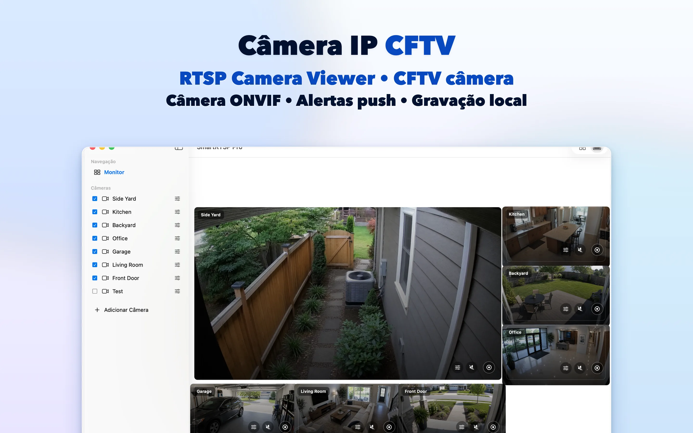
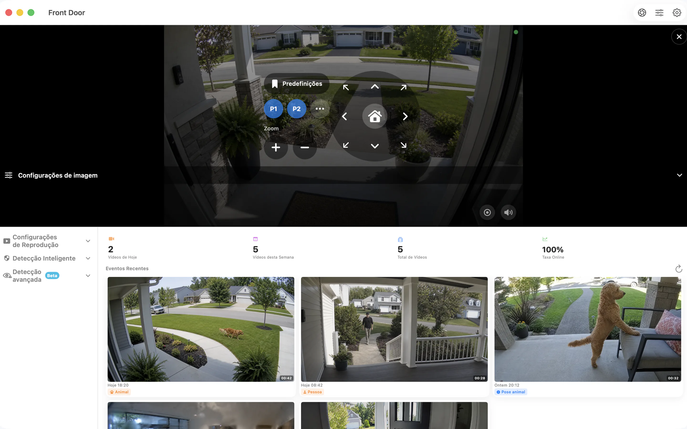

# SmartRTSP para Mac — Visualização e gravação de câmaras RTSP e ONVIF

Dê espaço às suas câmaras IP na secretária do Mac. O SmartRTSP combina imagens em direto, gravação local e consulta de eventos para uma secretária, receção ou posto de monitorização de um pequeno negócio.

**[Descarregar via App Store](https://apps.apple.com/us/app/smart-rtsp-pro-ip-cam-viewer/id6759788063?mt=12)** · [Site oficial](https://www.smartrtsp.com/)

**Escolha o seu idioma**

[English](./README.md) · [Deutsch](./README.de.md) · [Français](./README.fr.md) · [Español](./README.es.md) · [Italiano](./README.it.md) · **Português** · [Nederlands](./README.nl.md) · [Polski](./README.pl.md) · [Svenska](./README.sv.md) · [Suomi](./README.fi.md) · [Română](./README.ro.md) · [Русский](./README.ru.md) · [Українська](./README.uk.md) · [Türkçe](./README.tr.md)

Mantenha as câmaras à vista enquanto trabalha, organize várias imagens e reveja gravações numa interface de computador concebida para um ecrã maior.

## Capturas de ecrã da aplicação

*Esta captura de ecrã da aplicação apresenta a interface em português do Brasil.*

## Principais funcionalidades

- **Ligue as suas câmaras** — Adicione transmissões RTSP compatíveis ou descubra câmaras ONVIF na sua rede local.
- **Escolha a visualização** — Alterne entre imagens individuais e uma disposição multicâmara adequada ao seu ecrã.
- **Grave e reveja** — Guarde gravações localmente e volte aos momentos importantes no histórico de gravações.
- **Encontre eventos relevantes** — Configure as opções suportadas de deteção de movimento, pessoas ou sons para identificar momentos que vale a pena rever.
- **Controle câmaras compatíveis** — Utilize os controlos de panorâmica, inclinação e zoom quando a câmara disponibilizar um serviço ONVIF PTZ suportado.
- **Veja na rede local** — A visualização local de câmaras não exige uma conta SmartRTSP. Poderá ainda precisar dos dados de acesso da câmara.

## SmartRTSP no dia a dia

- **Casa e entradas** — Consulte as câmaras que cobrem uma entrada, um acesso para automóveis ou outras áreas da sua casa.
- **Lojas e receções** — Acompanhe várias zonas de uma pequena loja ou receção num único ecrã.
- **Animais e consultas rápidas** — Abra uma câmara compatível para ver rapidamente a zona do seu animal de estimação ou outra divisão.

## Primeiros passos

1. Instale o SmartRTSP através da ligação para a loja oficial apresentada abaixo.
2. Ligue o dispositivo e a câmara à mesma rede local. Depois, procure a câmara ou adicione o endereço da transmissão suportada.
3. Introduza os dados de acesso da câmara quando necessário, abra a imagem em direto e escolha as funcionalidades de visualização ou gravação que pretende utilizar.

## Perguntas frequentes

### Que câmaras funcionam com o SmartRTSP?

A câmara ou o gravador deve fornecer uma transmissão RTSP ou um serviço ONVIF suportado. A compatibilidade depende do modelo, do firmware e das definições ativas. Os controlos PTZ também exigem uma câmara compatível.

### Preciso de uma conta SmartRTSP?

Pode ver câmaras na rede local sem uma conta SmartRTSP. A sua câmara poderá exigir um nome de utilizador e uma palavra-passe próprios.

### A aplicação inclui todas as funcionalidades ao descarregar?

Os períodos de avaliação, as funcionalidades Pro, as compras disponíveis e os preços variam consoante a plataforma. Consulte a aplicação e a sua página oficial na loja para conhecer a oferta atual. A visualização multicâmara, a gravação e a deteção poderão exigir Pro.

### Onde ficam guardadas as gravações?

As gravações são guardadas no dispositivo ou num local à sua escolha, quando suportado. Os serviços de rede opcionais seguem as definições que ativar.

## Descarregar o SmartRTSP

**[Descarregar via App Store](https://apps.apple.com/us/app/smart-rtsp-pro-ip-cam-viewer/id6759788063?mt=12)**

## Ligações oficiais

- [Site oficial](https://www.smartrtsp.com/)
- [Ajuda e guias para câmaras](https://www.smartrtsp.com/guides/)
- [Política de privacidade](https://www.smartrtsp.com/privacy)

## Outras plataformas

[iPhone](https://github.com/smartrtsp/smartrtsp-iphone/blob/main/README.pt.md) · [iPad](https://github.com/smartrtsp/smartrtsp-ipad/blob/main/README.pt.md) · [Apple TV](https://github.com/smartrtsp/smartrtsp-tvos/blob/main/README.pt.md) · [Telemóveis e tablets Android](https://github.com/smartrtsp/smartrtsp-android/blob/main/README.pt.md) · [Android TV e Google TV](https://github.com/smartrtsp/smartrtsp-android-tv/blob/main/README.pt.md) · [Windows](https://github.com/smartrtsp/smartrtsp-windows/blob/main/README.pt.md)
