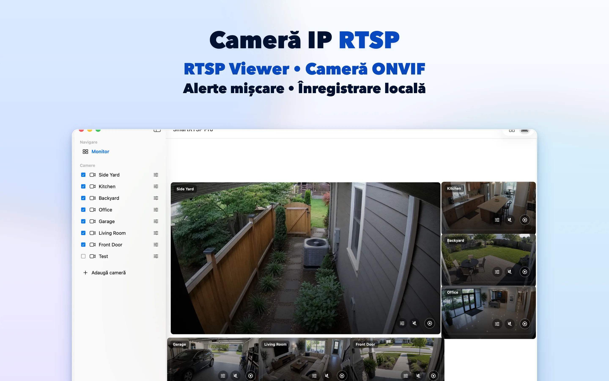
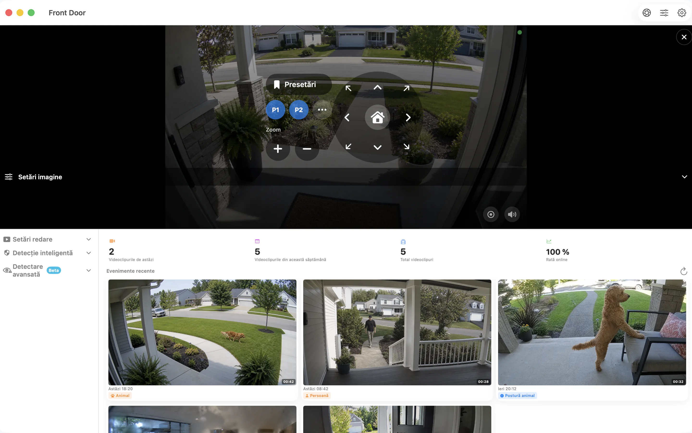

# SmartRTSP pentru Mac — Vizualizare și înregistrare camere RTSP și ONVIF

Fă loc camerelor IP pe ecranul Mac-ului. SmartRTSP reunește vizualizarea în direct, înregistrarea locală și consultarea evenimentelor pentru birou, recepție sau o mică afacere.

**[Descarcă din App Store](https://apps.apple.com/us/app/smart-rtsp-pro-ip-cam-viewer/id6759788063?mt=12)** · [Site oficial](https://www.smartrtsp.com/)

**Alege limba**

[English](./README.md) · [Deutsch](./README.de.md) · [Français](./README.fr.md) · [Español](./README.es.md) · [Italiano](./README.it.md) · [Português](./README.pt.md) · [Nederlands](./README.nl.md) · [Polski](./README.pl.md) · [Svenska](./README.sv.md) · [Suomi](./README.fi.md) · **Română** · [Русский](./README.ru.md) · [Українська](./README.uk.md) · [Türkçe](./README.tr.md)

Păstrează camerele la vedere în timp ce lucrezi, organizează mai multe fluxuri și consultă înregistrările într-o interfață pentru ecrane mari.

## Imagini din aplicație

## Funcții principale

- **Conectează camerele** — Adaugă fluxuri RTSP compatibile sau descoperă camere ONVIF din rețeaua locală.
- **Alege vizualizarea** — Comută între o singură cameră și un aranjament multicameră potrivit ecranului.
- **Înregistrează și revino la imagini** — Salvează înregistrări local și găsește momentele importante în istoricul înregistrărilor.
- **Găsește evenimente utile** — Configurează opțiunile acceptate de detectare a mișcării, persoanelor sau sunetului pentru a identifica momentele de revăzut.
- **Controlează camere compatibile** — Folosește rotirea, înclinarea și zoomul când camera oferă un serviciu ONVIF PTZ acceptat.
- **Vizualizare locală** — Vizualizarea locală nu necesită un cont SmartRTSP. Pot fi necesare datele de autentificare ale camerei.

## Unde poți folosi SmartRTSP

- **Casă și intrări** — Verifică imaginile de la intrare, alee sau din alte zone ale casei.
- **Magazine și recepții** — Urmărește mai multe zone ale unui magazin mic sau ale recepției de pe un singur ecran.
- **Animale și verificări zilnice** — Deschide o cameră compatibilă pentru o privire rapidă la zona animalelor sau în altă încăpere.

## Primii pași

1. Instalează SmartRTSP folosind linkul către magazinul oficial de mai jos.
2. Conectează dispozitivul și camera la aceeași rețea locală, apoi descoperă camera sau adaugă adresa fluxului compatibil.
3. Introdu datele de autentificare ale camerei când sunt necesare, deschide vizualizarea în direct și alege funcțiile dorite.

## Întrebări frecvente

### Ce camere funcționează cu SmartRTSP?

Camera sau recorderul trebuie să ofere un flux RTSP sau un serviciu ONVIF acceptat. Compatibilitatea depinde de model, firmware și setările activate. Comenzile PTZ necesită și o cameră compatibilă.

### Am nevoie de un cont SmartRTSP?

Poți vizualiza camerele local fără un cont SmartRTSP. Camera poate solicita propriul nume de utilizator și propria parolă.

### Sunt incluse toate funcțiile la descărcare?

Perioadele de probă, funcțiile Pro, achizițiile disponibile și prețurile diferă între platforme. Consultă aplicația și pagina sa oficială din magazin pentru oferta actuală. Vizualizarea multicameră, înregistrarea și detectarea pot necesita Pro.

### Unde sunt păstrate înregistrările?

Înregistrările sunt salvate pe dispozitiv sau într-o locație aleasă de tine, acolo unde este posibil. Serviciile de rețea opționale urmează setările pe care le activezi.

## Descarcă SmartRTSP

**[Descarcă din App Store](https://apps.apple.com/us/app/smart-rtsp-pro-ip-cam-viewer/id6759788063?mt=12)**

## Linkuri oficiale

- [Site oficial](https://www.smartrtsp.com/)
- [Ajutor și ghiduri pentru camere](https://www.smartrtsp.com/guides/)
- [Politica de confidențialitate](https://www.smartrtsp.com/privacy)

## Alte platforme

[iPhone](https://github.com/smartrtsp/smartrtsp-iphone/blob/main/README.ro.md) · [iPad](https://github.com/smartrtsp/smartrtsp-ipad/blob/main/README.ro.md) · [Apple TV](https://github.com/smartrtsp/smartrtsp-tvos/blob/main/README.ro.md) · [Telefoane și tablete Android](https://github.com/smartrtsp/smartrtsp-android/blob/main/README.ro.md) · [Android TV și Google TV](https://github.com/smartrtsp/smartrtsp-android-tv/blob/main/README.ro.md) · [Windows](https://github.com/smartrtsp/smartrtsp-windows/blob/main/README.ro.md)
