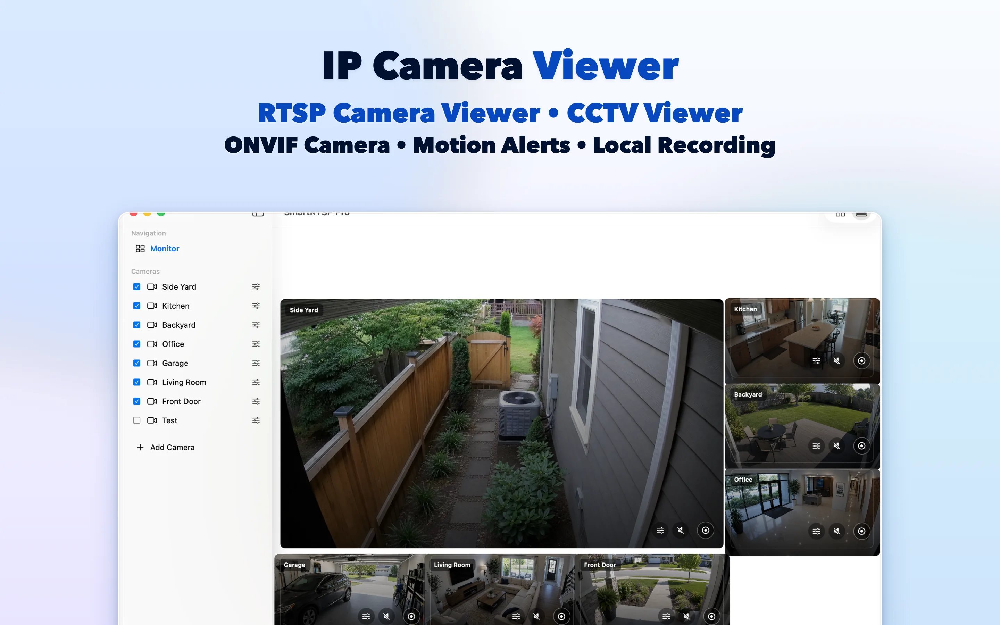
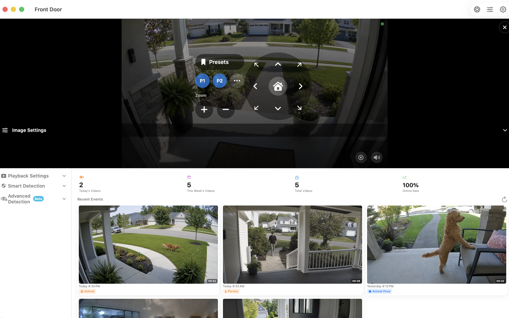

# SmartRTSP för Mac — Visa och spela in RTSP- och ONVIF-kameror

Ge dina IP-kameror en plats på Mac-skrivbordet. SmartRTSP kombinerar livebilder, lokal inspelning och granskning av händelser för skrivbordet, receptionen eller det mindre företagets övervakningsplats.

**[Ladda ned från App Store](https://apps.apple.com/us/app/smart-rtsp-pro-ip-cam-viewer/id6759788063?mt=12)** · [Officiell webbplats](https://www.smartrtsp.com/)

**Välj språk**

[English](./README.md) · [Deutsch](./README.de.md) · [Français](./README.fr.md) · [Español](./README.es.md) · [Italiano](./README.it.md) · [Português](./README.pt.md) · [Nederlands](./README.nl.md) · [Polski](./README.pl.md) · **Svenska** · [Suomi](./README.fi.md) · [Română](./README.ro.md) · [Русский](./README.ru.md) · [Українська](./README.uk.md) · [Türkçe](./README.tr.md)

Ha kamerabilderna bredvid ditt arbete, ordna flera videoströmmar och granska inspelningar i ett skrivbordsgränssnitt utformat för en större skärm.

## Skärmbilder från appen

*Den här skärmbilden visar appen på engelska.*

## Viktiga funktioner

- **Anslut dina kameror** — Lägg till kompatibla RTSP-strömmar eller hitta ONVIF-kameror i ditt lokala nätverk.
- **Välj din vy** — Växla mellan enskilda kamerabilder och en layout med flera kameror som passar skärmen.
- **Spela in och granska** — Spara inspelningar lokalt och återvänd till viktiga ögonblick i inspelningshistoriken.
- **Hitta relevanta händelser** — Ställ in de alternativ för rörelse-, person- eller ljuddetektering som stöds för att hitta ögonblick du vill granska.
- **Styr kompatibla kameror** — Använd panorering, lutning och zoom när kameran erbjuder en ONVIF PTZ-tjänst som stöds.
- **Visa lokalt** — Lokal kameravisning kräver inget SmartRTSP-konto. Kamerans egna inloggningsuppgifter kan fortfarande behövas.

## Använd SmartRTSP i vardagen

- **Hemmet och entréer** — Kontrollera kameror vid en entré, uppfart eller annan del av hemmet.
- **Butiker och receptioner** — Håll uppsikt över flera delar av en mindre butik eller reception från en och samma skärm.
- **Husdjur och vardagskontroller** — Öppna en kompatibel kamera för att snabbt titta till ett husdjur eller ett annat rum.

## Kom igång

1. Installera SmartRTSP via den officiella butikslänken nedan.
2. Anslut enheten och kameran till samma lokala nätverk. Sök sedan efter kameran eller lägg till en strömadress som stöds.
3. Ange kamerans inloggningsuppgifter om det behövs, öppna livevyn och välj de visnings- eller inspelningsfunktioner du vill använda.

## Vanliga frågor

### Vilka kameror fungerar med SmartRTSP?

Kameran eller inspelaren måste erbjuda en RTSP-ström eller ONVIF-tjänst som stöds. Kompatibiliteten beror på modell, fast programvara och aktiverade inställningar. PTZ-kontroller kräver också en kompatibel kamera.

### Behöver jag ett SmartRTSP-konto?

Du kan visa lokala kamerabilder utan ett SmartRTSP-konto. Kameran kan kräva ett eget användarnamn och lösenord.

### Ingår alla funktioner när jag laddar ned appen?

Provperioder, Pro-funktioner, tillgängliga köp och priser varierar mellan plattformarna. Se appen och dess officiella butikssida för det aktuella erbjudandet. Funktioner som visning av flera kameror, inspelning och detektering kan kräva Pro.

### Var sparas inspelningarna?

Inspelningar sparas på din enhet eller på en plats du väljer där det stöds. Valfria nätverkstjänster följer de inställningar du aktiverar.

## Ladda ned SmartRTSP

**[Ladda ned från App Store](https://apps.apple.com/us/app/smart-rtsp-pro-ip-cam-viewer/id6759788063?mt=12)**

## Officiella länkar

- [Officiell webbplats](https://www.smartrtsp.com/)
- [Hjälp och kameraguider](https://www.smartrtsp.com/guides/)
- [Integritetspolicy](https://www.smartrtsp.com/privacy)

## Andra plattformar

[iPhone](https://github.com/smartrtsp/smartrtsp-iphone/blob/main/README.sv.md) · [iPad](https://github.com/smartrtsp/smartrtsp-ipad/blob/main/README.sv.md) · [Apple TV](https://github.com/smartrtsp/smartrtsp-tvos/blob/main/README.sv.md) · [Android-telefoner och surfplattor](https://github.com/smartrtsp/smartrtsp-android/blob/main/README.sv.md) · [Android TV och Google TV](https://github.com/smartrtsp/smartrtsp-android-tv/blob/main/README.sv.md) · [Windows](https://github.com/smartrtsp/smartrtsp-windows/blob/main/README.sv.md)
