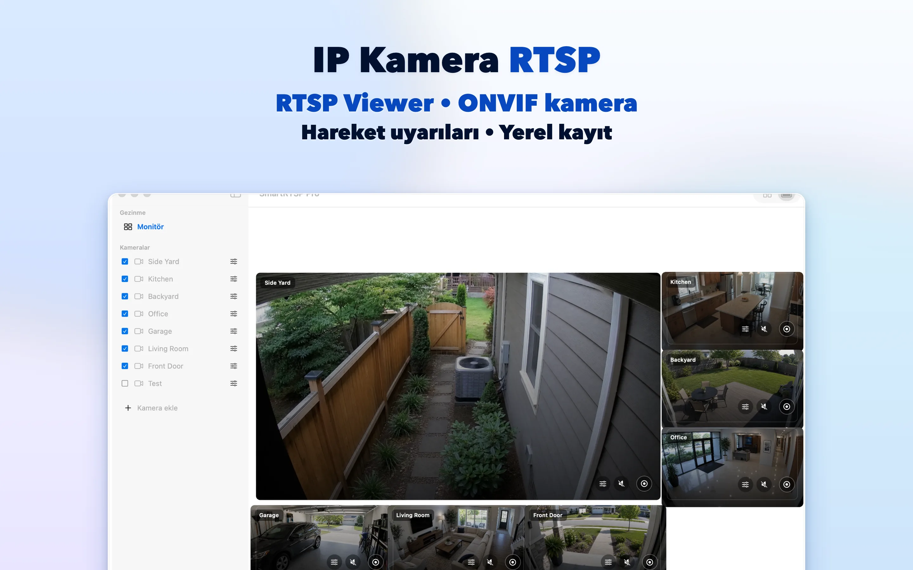
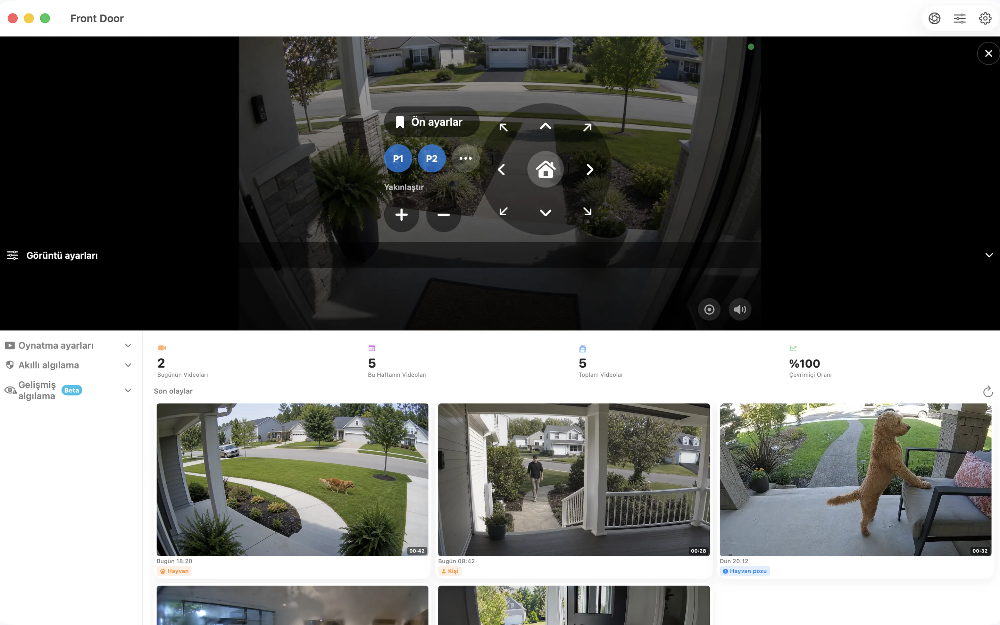

# Mac için SmartRTSP — RTSP ve ONVIF Kamera İzleme ve Kayıt

Mac masaüstünüzde IP kameralarınıza yer açın. SmartRTSP, masa, resepsiyon veya küçük işletme izleme noktası için canlı görüntüleri, yerel kaydı ve olay incelemeyi bir araya getirir.

**[App Store üzerinden indirin](https://apps.apple.com/us/app/smart-rtsp-pro-ip-cam-viewer/id6759788063?mt=12)** · [Resmî web sitesi](https://www.smartrtsp.com/)

**Dilinizi seçin**

[English](./README.md) · [Deutsch](./README.de.md) · [Français](./README.fr.md) · [Español](./README.es.md) · [Italiano](./README.it.md) · [Português](./README.pt.md) · [Nederlands](./README.nl.md) · [Polski](./README.pl.md) · [Svenska](./README.sv.md) · [Suomi](./README.fi.md) · [Română](./README.ro.md) · [Русский](./README.ru.md) · [Українська](./README.uk.md) · **Türkçe**

Çalışırken kamera görüntülerini açık tutun, birden fazla yayını düzenleyin ve büyük ekrana uygun masaüstü arayüzünden kayıtları inceleyin.

## Uygulama ekran görüntüleri

## Başlıca özellikler

- **Kameralarınızı bağlayın** — Uyumlu RTSP yayınları ekleyin veya yerel ağınızdaki ONVIF kameralarını keşfedin.
- **Görünümünüzü seçin** — Tek kamera görünümü ile ekranınıza uygun çok kameralı düzen arasında geçiş yapın.
- **Kaydedin ve inceleyin** — Kayıtları yerel olarak saklayın ve kayıt geçmişinden önemli anlara geri dönün.
- **Önemli olayları bulun** — İncelenmeye değer anları belirlemek için desteklenen hareket, insan veya ses algılama seçeneklerini yapılandırın.
- **Uyumlu kameraları yönetin** — Kamera desteklenen ONVIF PTZ hizmetini sunduğunda döndürme, eğme ve yakınlaştırma kontrollerini kullanın.
- **Yerel izlemeyi kullanın** — Yerel kamera izleme için SmartRTSP hesabı gerekmez. Kameranızın giriş bilgileri yine de gerekli olabilir.

## SmartRTSP kullanım alanları

- **Ev ve girişler** — Evinizin girişini, garaj yolunu veya diğer alanlarını gösteren kameraları kontrol edin.
- **Mağaza ve resepsiyonlar** — Küçük mağazanın veya resepsiyon alanının farklı bölümlerini tek ekrandan takip edin.
- **Evcil hayvanlar ve günlük kontroller** — Evcil hayvanınızın alanına veya başka bir odaya hızlıca bakmak için uyumlu kamerayı açın.

## İlk adımlar

1. Aşağıdaki resmî mağaza bağlantısından SmartRTSP'yi yükleyin.
2. Cihazınızı ve kameranızı aynı yerel ağa bağlayın, ardından kamerayı keşfedin veya desteklenen yayın adresini ekleyin.
3. Gerektiğinde kamera giriş bilgilerini girin, canlı görünümü açın ve istediğiniz izleme veya kayıt özelliklerini seçin.

## Sık sorulan sorular

### SmartRTSP hangi kameralarla çalışır?

Kamera veya kayıt cihazı desteklenen bir RTSP yayını ya da ONVIF hizmeti sunmalıdır. Uyumluluk model, ürün yazılımı ve etkinleştirilen ayarlara bağlıdır. PTZ kontrolleri de uyumlu kamera gerektirir.

### SmartRTSP hesabı gerekir mi?

Yerel kamera izlemeyi SmartRTSP hesabı olmadan kullanabilirsiniz. Kameranız kendi kullanıcı adını ve parolasını isteyebilir.

### İndirmeye tüm özellikler dâhil mi?

Denemeler, Pro özellikleri, kullanılabilir satın alımlar ve fiyatlar platforma göre değişir. Güncel teklif için uygulamaya ve resmî mağaza sayfasına bakın. Çok kameralı izleme, kayıt ve algılama gibi özellikler Pro gerektirebilir.

### Kayıtlar nerede saklanır?

Kayıtlar cihazınızda veya desteklendiğinde seçtiğiniz konumda saklanır. İsteğe bağlı ağ hizmetleri etkinleştirdiğiniz ayarlara göre çalışır.

## SmartRTSP'yi indirin

**[App Store üzerinden indirin](https://apps.apple.com/us/app/smart-rtsp-pro-ip-cam-viewer/id6759788063?mt=12)**

## Resmî bağlantılar

- [Resmî web sitesi](https://www.smartrtsp.com/)
- [Yardım ve kamera rehberleri](https://www.smartrtsp.com/guides/)
- [Gizlilik politikası](https://www.smartrtsp.com/privacy)

## Diğer platformlar

[iPhone](https://github.com/smartrtsp/smartrtsp-iphone/blob/main/README.tr.md) · [iPad](https://github.com/smartrtsp/smartrtsp-ipad/blob/main/README.tr.md) · [Apple TV](https://github.com/smartrtsp/smartrtsp-tvos/blob/main/README.tr.md) · [Android telefon ve tabletler](https://github.com/smartrtsp/smartrtsp-android/blob/main/README.tr.md) · [Android TV ve Google TV](https://github.com/smartrtsp/smartrtsp-android-tv/blob/main/README.tr.md) · [Windows](https://github.com/smartrtsp/smartrtsp-windows/blob/main/README.tr.md)
