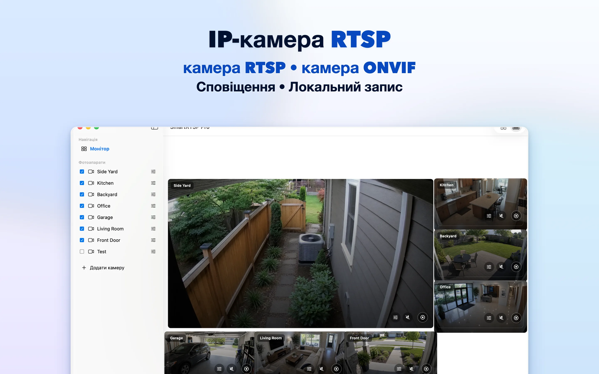
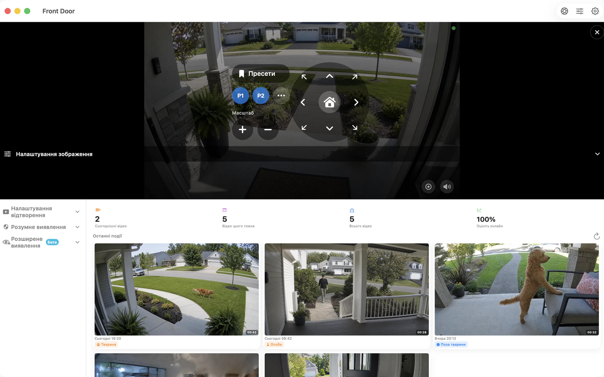

# SmartRTSP для Mac — Перегляд і запис камер RTSP та ONVIF

Знайдіть місце для IP-камер на робочому столі Mac. SmartRTSP поєднує відео в реальному часі, локальний запис і перегляд подій для робочого місця, зони прийому відвідувачів або поста спостереження в невеликій компанії.

**[Завантажити з App Store](https://apps.apple.com/us/app/smart-rtsp-pro-ip-cam-viewer/id6759788063?mt=12)** · [Офіційний сайт](https://www.smartrtsp.com/)

**Виберіть мову**

[English](./README.md) · [Deutsch](./README.de.md) · [Français](./README.fr.md) · [Español](./README.es.md) · [Italiano](./README.it.md) · [Português](./README.pt.md) · [Nederlands](./README.nl.md) · [Polski](./README.pl.md) · [Svenska](./README.sv.md) · [Suomi](./README.fi.md) · [Română](./README.ro.md) · [Русский](./README.ru.md) · **Українська** · [Türkçe](./README.tr.md)

Тримайте зображення з камер перед очима під час роботи, впорядковуйте кілька відеопотоків і переглядайте записи в настільному інтерфейсі, розробленому для більшого екрана.

## Знімки екрана застосунку

## Основні можливості

- **Підключайте камери** — Додавайте сумісні потоки RTSP або знаходьте камери ONVIF у локальній мережі.
- **Вибирайте зручний вигляд** — Перемикайтеся між окремими камерами та макетом із кількома камерами, який підходить для вашого екрана.
- **Записуйте й переглядайте** — Зберігайте записи локально та повертайтеся до важливих моментів в історії записів.
- **Знаходьте важливі події** — Налаштовуйте підтримувані функції виявлення руху, людей або звуку, щоб знаходити моменти, які варто переглянути.
- **Керуйте сумісними камерами** — Користуйтеся поворотом, нахилом і масштабуванням, якщо камера надає підтримувану службу ONVIF PTZ.
- **Переглядайте локально** — Для локального перегляду камер обліковий запис SmartRTSP не потрібен. Водночас можуть знадобитися дані для входу в саму камеру.

## Де стане в пригоді SmartRTSP

- **Дім і входи** — Перевіряйте камери біля входу, на під’їзній доріжці або в інших місцях навколо дому.
- **Магазини й зони прийому відвідувачів** — Стежте за кількома ділянками невеликого магазину або зони прийому відвідувачів з одного екрана.
- **Улюбленці й щоденні перевірки** — Відкрийте сумісну камеру, щоб швидко подивитися на улюбленця або в іншу кімнату.

## Початок роботи

1. Установіть SmartRTSP за посиланням на офіційний магазин нижче.
2. Підключіть пристрій і камеру до однієї локальної мережі, а потім знайдіть камеру або додайте підтримувану адресу відеопотоку.
3. За потреби введіть дані для входу в камеру, відкрийте відео в реальному часі та виберіть потрібні функції перегляду чи запису.

## Поширені запитання

### Які камери працюють зі SmartRTSP?

Камера або відеореєстратор мають надавати підтримуваний потік RTSP або службу ONVIF. Сумісність залежить від моделі, прошивки та ввімкнених налаштувань. Для керування PTZ також потрібна сумісна камера.

### Чи потрібен обліковий запис SmartRTSP?

Локальні камери можна переглядати без облікового запису SmartRTSP. Сама камера може вимагати окремі ім’я користувача та пароль.

### Чи входять усі функції до завантаження?

Пробні періоди, функції Pro, доступні покупки й ціни залежать від платформи. Актуальні умови наведено в застосунку та на його сторінці в офіційному магазині. Для перегляду кількох камер, запису й виявлення подій може знадобитися Pro.

### Де зберігаються записи?

Записи зберігаються на вашому пристрої або у вибраному вами місці, якщо це підтримується. Необов’язкові мережеві служби працюють відповідно до ввімкнених налаштувань.

## Завантажити SmartRTSP

**[Завантажити з App Store](https://apps.apple.com/us/app/smart-rtsp-pro-ip-cam-viewer/id6759788063?mt=12)**

## Офіційні посилання

- [Офіційний сайт](https://www.smartrtsp.com/)
- [Допомога й посібники для камер](https://www.smartrtsp.com/guides/)
- [Політика конфіденційності](https://www.smartrtsp.com/privacy)

## Інші платформи

[iPhone](https://github.com/smartrtsp/smartrtsp-iphone/blob/main/README.uk.md) · [iPad](https://github.com/smartrtsp/smartrtsp-ipad/blob/main/README.uk.md) · [Apple TV](https://github.com/smartrtsp/smartrtsp-tvos/blob/main/README.uk.md) · [Телефони й планшети Android](https://github.com/smartrtsp/smartrtsp-android/blob/main/README.uk.md) · [Android TV і Google TV](https://github.com/smartrtsp/smartrtsp-android-tv/blob/main/README.uk.md) · [Windows](https://github.com/smartrtsp/smartrtsp-windows/blob/main/README.uk.md)
